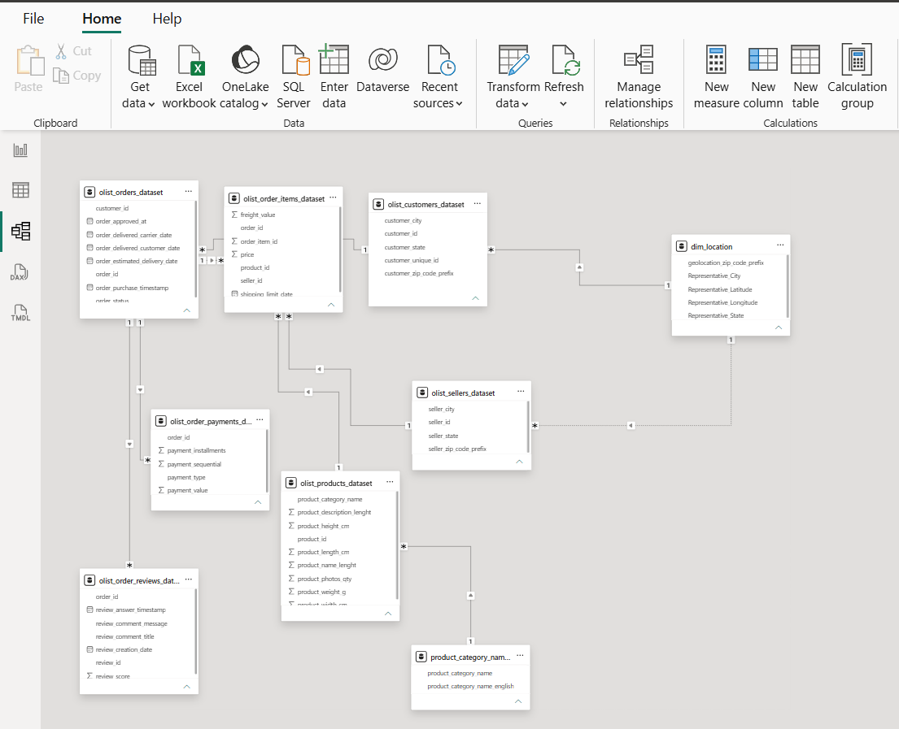

# Data Modeling and Location Dimension Report

**Project:** Olist E-Commerce Business Performance Analysis  
**Platform:** Microsoft Power BI / Power Query  
**Stage:** Data preparation, geographic enrichment, and relationship modeling

## 1. Objective

Prepare a reporting-ready Power BI model for analyzing Olist e-commerce performance, while preserving data-quality decisions and keeping the semantic model focused on business analysis.

## 2. Location dimension development

The original Olist geolocation dataset did not cover every ZIP-code prefix found in the customer and seller datasets. We created a reusable `dim_location` table keyed by the **five-character ZIP-code prefix** (stored as text to preserve leading zeros).

### Geolocation-derived records

- Grouped geolocation observations by ZIP-code prefix.
- Selected representative city and state labels from the grouped observations, using the most frequent values rather than arbitrarily selecting a row.
- Checked that each selected city/state pair occurred together in the source observations.
- Calculated average latitude and longitude for each ZIP-code prefix.
- Result: **19,015 unique geolocation ZIP-code prefixes**.

### Coverage extensions

A left-anti comparison against the location dimension identified ZIP prefixes in the customer and seller data that were absent from the geolocation source.

| Stage | Additional unique ZIP prefixes | Cumulative unique ZIP prefixes |
|---|---:|---:|
| Geolocation-derived dimension | — | 19,015 |
| Customer-only locations | 157 | 19,172 |
| Seller-only locations | 5 | **19,177** |

The missing locations were added using their available city and state labels. **Latitude and longitude were deliberately left null** for these records rather than inventing coordinates. This means approximately 162 of 19,177 location records (0.84%) have no geolocation-derived coordinates. These locations can still support city/state analysis, but should be excluded or treated separately in coordinate-based maps.

The final `dim_location` fields are:

| Column | Purpose |
|---|---|
| `geolocation_zip_code_prefix` | Unique five-character geographic lookup key |
| `Representative_City` | Selected city label |
| `Representative_State` | Brazilian state abbreviation |
| `Representative_Latitude` | Mean latitude where source coordinates exist; otherwise null |
| `Representative_Longitude` | Mean longitude where source coordinates exist; otherwise null |

## 3. Reporting model

After disabling loading for six helper/intermediate queries and the original geolocation source query, the Power BI reporting model contains **nine loaded tables**:

1. `olist_orders_dataset`
2. `olist_order_items_dataset`
3. `olist_customers_dataset`
4. `olist_order_payments_dataset`
5. `olist_products_dataset`
6. `olist_order_reviews_dataset`
7. `olist_sellers_dataset`
8. `product_category_name_translation`
9. `dim_location`

### Relationships

The following nine relationships were confirmed in the Power BI model. They use **many-to-one (`*:1`) cardinality** and **single-direction filtering**.

| Many-side table | Join column | One-side table | Join column | Status |
|---|---|---|---|---|
| `olist_order_items_dataset` | `order_id` | `olist_orders_dataset` | `order_id` | Active |
| `olist_order_items_dataset` | `product_id` | `olist_products_dataset` | `product_id` | Active |
| `olist_order_items_dataset` | `seller_id` | `olist_sellers_dataset` | `seller_id` | Active |
| `olist_order_payments_dataset` | `order_id` | `olist_orders_dataset` | `order_id` | Active |
| `olist_order_reviews_dataset` | `order_id` | `olist_orders_dataset` | `order_id` | Active |
| `olist_orders_dataset` | `customer_id` | `olist_customers_dataset` | `customer_id` | Active |
| `olist_products_dataset` | `product_category_name` | `product_category_name_translation` | `product_category_name` | Active |
| `olist_customers_dataset` | `customer_zip_code_prefix` | `dim_location` | `geolocation_zip_code_prefix` | Active |
| `olist_sellers_dataset` | `seller_zip_code_prefix` | `dim_location` | `geolocation_zip_code_prefix` | **Inactive** |

**Why is the seller-to-location relationship inactive?** Activating both customer-to-location and seller-to-location relationships would create ambiguous filter paths through the orders and order-items tables. The seller relationship was retained as inactive for explicit use in future measures when seller geography is required (for example, via DAX `USERELATIONSHIP`, where appropriate).

**Modeling consideration:** Customer-location and seller-location analyses represent different geographic roles. Future report design should clearly label which role a visual uses and validate measure behavior when switching roles.

## 4. Power Query load optimization

Rather than deleting transformation or validation work, **Enable load** was disabled for these intermediate queries:

- `geolocation_location_lookup`
- `customer_zip_coverage_check`
- `seller_zip_coverage_check`
- `dim_geolocation`
- `dim_location_geolocation_only`
- `dim_location_customer_extended`
- `olist_geolocation_dataset` (original cleaned source)

These queries remain available to Power Query for refresh, auditability, and dependent transformations, but do not appear as separate tables in the final semantic model.

## 5. Data-quality and analytical limitations

- City names in the original geolocation records may have inconsistent spelling or accents. Representative labels improve lookup consistency but are not a substitute for a fully standardized Brazilian locality reference.
- Average coordinates summarize geolocation observations by ZIP-code prefix; they are not guaranteed to be the exact address or physical center of that prefix.
- Customer- and seller-only ZIP prefixes have **null coordinates**, not zero coordinates. Mapping visuals must handle them accordingly.
- The inactive seller-location relationship needs explicit handling in seller-geography DAX calculations.
- These modeling choices preserve records rather than silently discarding customers or sellers whose ZIP prefixes were absent from the geolocation source.

## 6. Model diagram

Add an exported screenshot of the final Power BI Model view to the repository, for example at `images/power-bi-data-model.png`, and embed it here:

```markdown

```

## 7. Next stage

Create and validate DAX measures for total revenue, order volume, average order value, fulfillment and delivery performance, product/category performance, and customer geography. Then develop the report pages and document KPI definitions and assumptions.
